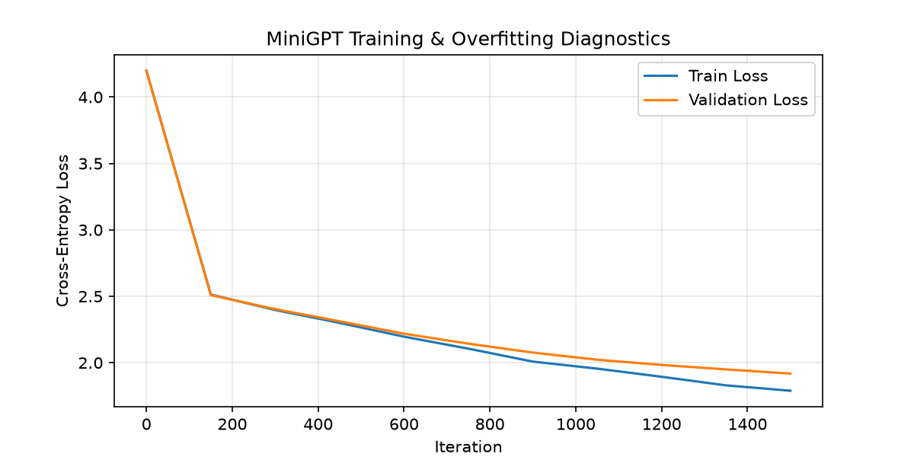

# MiniGPT

**Two decoder-only Transformer implementations in PyTorch.** Train an 812K-parameter character model on Tiny Shakespeare, stream pretrained GPT-2 completions, or chat locally with SmolLM2 and Qwen2.5 using a KV cache that carries across turns.

[Quick start](#quick-start) · [Instruct chat](#run-multi-turn-instruct-chat) · [Architecture](#architecture) · [Results](#results) · [Generated samples](#generated-samples) · [Project layout](#project-layout)

| Tiny Shakespeare checkpoint | Held-out character perplexity | Saved MPS benchmark at 1,024 tokens |
| --- | --- | --- |
| **812,288 parameters** | **6.824** | **1.72×** manual-to-SDPA speedup |

## Quick start

Run commands from the project root. The local checkpoint and tests were verified with **Python 3.14.6** and **PyTorch 2.15.0**.

```bash
python3 -m venv .venv
source .venv/bin/activate
python -m pip install -r requirements.txt
python -m pytest -q
```

### Run multi-turn Instruct chat

```bash
# SmolLM2 (default)
python -m src.run_instruct

# Qwen2.5
python -m src.run_instruct --model Qwen/Qwen2.5-0.5B-Instruct

# Resume a saved SmolLM2 conversation
python -m src.run_instruct --load-history outputs/chat_history.json
```

The CLI loads pretrained weights and the matching tokenizer from Hugging Face, then runs inference in MiniLlama on CUDA, MPS, or CPU, in that order. The first run may need to download the model and tokenizer. Replies stream as tokens arrive. The CLI waits for incomplete UTF-8 characters before printing and ends a reply on EOS, a recognized stop token, or the generation limit. Defaults are 256 new tokens, temperature `0.6`, and top-p `0.9`. Set `--temperature 0` for greedy decoding.

| Command | Effect |
| --- | --- |
| `history` | Show the conversation currently in memory. |
| `save` | Write the current messages to `outputs/chat_history.json` or overwrite the path passed to `--load-history`. |
| `clear` | Reset the conversation and the in-memory KV cache. |
| `quit` | Exit the chat. |

Each turn formats the conversation with the model's chat template and reserves space for `--max-tokens`. If the prompt exceeds that budget, the CLI drops the oldest user/assistant pairs while retaining the system message and current user prompt. During the session it finds the longest token prefix shared by the new prompt and the in-memory KV cache, trims the cache to that prefix, and prefills the remaining tokens. The terminal reports time to first token (TTFT), tokens per second, prefill tokens versus total prompt tokens, and context usage. Resuming a JSON file restores the messages and starts with an empty KV cache.

### Train on Tiny Shakespeare

```bash
python -m src.train
```

Training uses CUDA when available and CPU otherwise. It reads the local `input.txt` and downloads Tiny Shakespeare from the char-rnn repository if the file is missing. A completed run replaces `minigpt.pt` and `loss_curve.png` in the working directory.

### Generate from the local checkpoint

The example uses PyTorch's weights-only loader and allows the configuration class under both the saved and current module paths. Run it with the project-provided checkpoint.

```python
import torch

from src.generate import generate
from src.model import GPTConfig, MiniGPT
from src.tokenizer import CharTokenizer

torch.set_num_threads(1)
with torch.serialization.safe_globals([GPTConfig, (GPTConfig, "model.GPTConfig")]):
    checkpoint = torch.load("minigpt.pt", map_location="cpu", weights_only=True)

model = MiniGPT(checkpoint["config"]).eval()
model.load_state_dict(checkpoint["model"])
tokenizer = CharTokenizer(checkpoint["text_vocab"])

torch.manual_seed(42)
prompt = torch.tensor([tokenizer.encode("ROMEO:\n")])
output = generate(model, prompt, max_new_tokens=180, temperature=0.8, top_k=20)
print(tokenizer.decode(output[0].tolist()))
```

### Run pretrained GPT-2 interactively

```bash
python -m src.run_gpt2 --model gpt2 --max-tokens 120
```

The loader uses Hugging Face's GPT-2 tokenizer and copies pretrained weights into MiniGPT, transposing the GPT-2 `Conv1D` matrices for PyTorch linear layers. The first run may need to download model and tokenizer files. The CLI supports `gpt2`, `gpt2-medium`, and `gpt2-large` and selects CUDA, MPS, or CPU in that order. Completions stream in the terminal, with TTFT and tokens per second reported after each prompt. Use `--temperature 0` for greedy decoding, `--no-cache` to disable KV caching, and `quit` to exit.

## Architecture

### MiniGPT

Token and learned position embeddings feed pre-normalized decoder blocks. Each block applies causal multi-head self-attention with a combined QKV projection, followed by a GELU feed-forward network with a 4× expansion. Both sublayers use residual connections. A final LayerNorm feeds the vocabulary projection, which shares weights with the token embedding.

| Setting | Tiny Shakespeare checkpoint | Pretrained GPT-2 base |
| --- | ---: | ---: |
| Tokenization | Character | GPT-2 byte-level BPE |
| Vocabulary | 65 | 50,257 |
| Context | 128 characters | 1,024 tokens |
| Decoder blocks | 4 | 12 |
| Attention heads | 4 | 12 |
| Embedding width | 128 | 768 |
| Configured dropout | 0.1 | 0.0 |

[Model code](src/model.py) supports manual masked attention and PyTorch scaled dot-product attention (SDPA). [Generation](src/generate.py) supports greedy decoding and temperature, top-k, and top-p sampling. The KV cache stores each layer's keys and values after processing the prompt, then processes one new token at a time until the context window fills. [Tokenizer code](src/tokenizer.py) also includes a standalone educational byte-level BPE implementation.

`generate_stream()` yields each new token tensor as it is produced. The existing `generate()` API consumes the stream and returns the full sequence, including the prompt.

### MiniLlama

MiniLlama uses RMSNorm before each sublayer and at the output, rotary position embeddings (RoPE) on queries and keys, grouped-query attention (GQA), and a gated SwiGLU feed-forward network. GQA lets groups of query heads share key/value heads, reducing the number of heads stored in the KV cache. The loader reads the checkpoint's configuration and enables QKV projection biases for Qwen2.5. SmolLM2 uses bias-free QKV projections. The checkpoint configuration also controls embedding weight tying. [MiniLlama implementation](src/llama_model.py)

## Training and evaluation

The training script assigns character IDs using the full corpus vocabulary, then splits the **1,115,394 characters** contiguously into the first 90% for training and the last 10% for validation. Each batch samples 64 windows of 128 characters with targets shifted one character ahead. The objective is next-character cross-entropy.

| Training setting | Value |
| --- | --- |
| Optimizer | AdamW, learning rate `3e-4`, betas `(0.9, 0.95)` |
| Regularization | Weight decay `0.1` on matrix parameters, dropout `0.1` |
| Gradient clipping | Global norm `1.0` |
| Seed | `42` |
| Training loop | Steps 0–1,500 inclusive, 1,501 optimizer updates |
| Loss reporting | Every 150 steps before the update, averaging 25 random batches per split in evaluation mode |

## Results

### Tiny Shakespeare



Both curves fall from about 4.2, with validation loss ending above training loss. The plot shows the saved training history. The table below comes from a fresh CPU evaluation of [the saved checkpoint](minigpt.pt).

| Split | Characters | Cross-entropy (nats/character) | Character perplexity |
| --- | ---: | ---: | ---: |
| Train | 1,003,854 | 1.781 | 5.933 |
| Validation | 111,540 | 1.920 | 6.824 |

To reproduce the table, load the checkpoint as above and run the following in the same Python session. Each split uses a fresh CPU random generator seeded with 42 and 25 batches sampled with replacement. Perplexity is the exponential of mean cross-entropy.

```python
from math import exp
from pathlib import Path

from src.train import get_batch

text = Path("input.txt").read_text(encoding="utf-8")
data = torch.tensor(tokenizer.encode(text))
cut = int(0.9 * len(data))

with torch.inference_mode():
    for name, split in (("Train", data[:cut]), ("Validation", data[cut:])):
        torch.manual_seed(42)
        losses = []
        for _ in range(25):
            x, y = get_batch(split, model.config.block_size, 64, "cpu")
            _, loss, _ = model(x, y)
            losses.append(loss.item())
        mean = sum(losses) / len(losses)
        print(f"{name}  loss={mean:.3f}  perplexity={exp(mean):.3f}")
```

### Attention benchmark and GPT-2 parity

The [saved MPS report](outputs/benchmark_results.txt) measures mean end-to-end forward latency with batch size 4, identical weights and synthetic inputs, three warm-up passes, and 15 timed passes per backend. All three sequence lengths passed the logit comparison (`atol=1e-5`, `rtol=1e-4`).

| Sequence length | Manual | PyTorch SDPA | Speedup | Max absolute logit difference |
| ---: | ---: | ---: | ---: | ---: |
| 256 | 13.92 ms | 11.41 ms | 1.22× | 3.34e-6 |
| 512 | 33.38 ms | 23.55 ms | 1.42× | 2.98e-6 |
| 1,024 | 86.35 ms | 50.26 ms | 1.72× | 3.46e-6 |

The same report records a **4.58e-5** maximum absolute logit error against Hugging Face GPT-2 on a fixed eight-token prompt (`atol=1e-4`, `rtol=1e-4`). The local test suite passed **10 tests** covering causal masking in forward and backward passes, manual/SDPA agreement, cached/uncached decoding parity, and tokenizer round trips.

```bash
python -m src.benchmark
```

This command may download GPT-2 weights and replaces `outputs/benchmark_results.txt` after both checks finish. The reported speedups compare attention implementations. KV-cache correctness is covered by the tests.

### Continuous integration

The GitHub Actions workflow runs on pushes and pull requests targeting `main`. It installs CPU-only PyTorch on Ubuntu with Python 3.11 and runs `python -m pytest tests/ -v`. The suite exercises the existing MiniGPT and tokenizer paths. The saved benchmark concerns MiniGPT and GPT-2, and Instruct chat reports its timing per turn. [CI workflow](.github/workflows/tests.yml)

## Generated samples

These are verbatim continuations from the Tiny Shakespeare checkpoint, including each prompt on the first line. Both use CPU, temperature 0.8, top-k 20, and 180 new characters.

**`ROMEO:` · seed 42**

```text
ROMEO:
You lord shat may the such crund, on annd the farther.

DUKE OF YORK:
No, reace be that strught heart, that is n
I come the mine done hind the hearl a wbord areng to runest not hea
```

**`JULIET:` · seed 43**

```text
JULIET:
The this of a your the plarse such hall ont they thou to rilds.

Serveprd:
I call for thou manstry bold and my the riest,
When this prade have hather; I'll forth, lord thunds;
As s
```

## Limitations

- The Tiny Shakespeare model learns dialogue formatting and some local patterns, but often produces invented words and incoherent sentences. Its tokenizer accepts only characters in the training corpus vocabulary.
- Validation measures sampled next-character prediction on a contiguous slice of the same corpus. It gives a within-corpus estimate, and its perplexity depends on character tokenization.
- Cached MiniGPT generation requires a nonempty prompt that fits the context window. Once the cache fills, generation rebuilds it from the latest full window on each subsequent step.
- Instruct chat caps model context at 4,096 tokens and reserves part of that window for the reply. Keep the current prompt within the remaining budget, since history trimming cannot shorten that message. Cache reuse depends on an exact token-prefix match, and a JSON save contains only the messages still in memory.
- The saved timings are specific to the recorded MPS run. MPS reports current allocated memory, which cannot establish a peak-memory comparison. GPT-2 logit parity was measured on one prompt.

## Project layout

| Path | Purpose |
| --- | --- |
| [`src/model.py`](src/model.py) | MiniGPT blocks and attention backends |
| [`src/llama_model.py`](src/llama_model.py) | MiniLlama blocks with RMSNorm, RoPE, GQA, and SwiGLU |
| [`src/tokenizer.py`](src/tokenizer.py) | Character tokenizer and educational byte-level BPE |
| [`src/train.py`](src/train.py) | Tiny Shakespeare training, loss tracking, and checkpoint export |
| [`src/generate.py`](src/generate.py) | MiniGPT streaming, full-sequence generation, and KV caching |
| [`src/run_gpt2.py`](src/run_gpt2.py) | GPT-2 weight import, streaming CLI, and timing |
| [`src/run_instruct.py`](src/run_instruct.py) | Instruct weight import, streaming chat, cache reuse, and session history |
| [`src/benchmark.py`](src/benchmark.py) | Attention timing and Hugging Face logit parity |
| [`tests/`](tests/) | Causality, cache, attention, and tokenizer tests |
| [`.github/workflows/tests.yml`](.github/workflows/tests.yml) | CPU-only test workflow for `main` |
| [`input.txt`](input.txt) · [`minigpt.pt`](minigpt.pt) · [`loss_curve.png`](loss_curve.png) | Corpus, trained checkpoint, and saved training plot |
| [`outputs/benchmark_results.txt`](outputs/benchmark_results.txt) | Saved MPS benchmark and GPT-2 parity report |
| [`requirements.txt`](requirements.txt) | Python dependencies |
